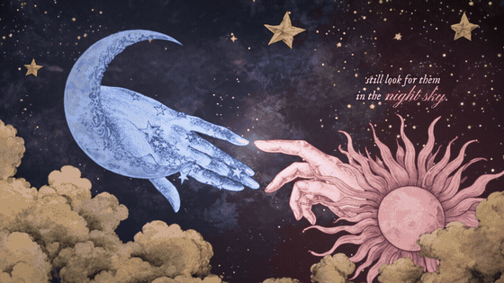
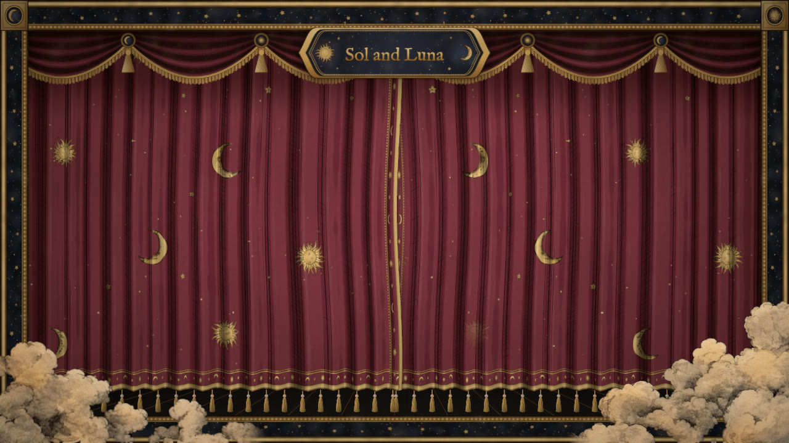
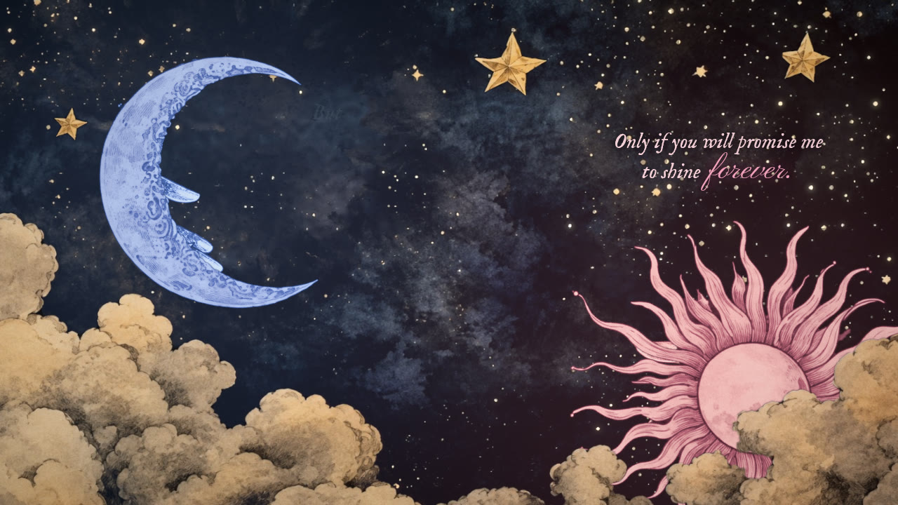
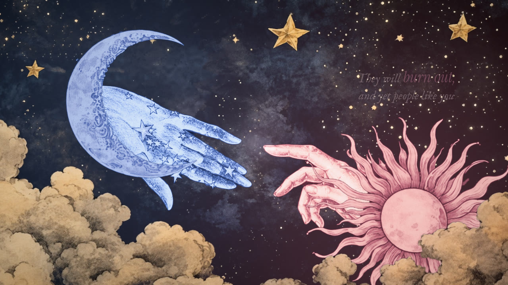
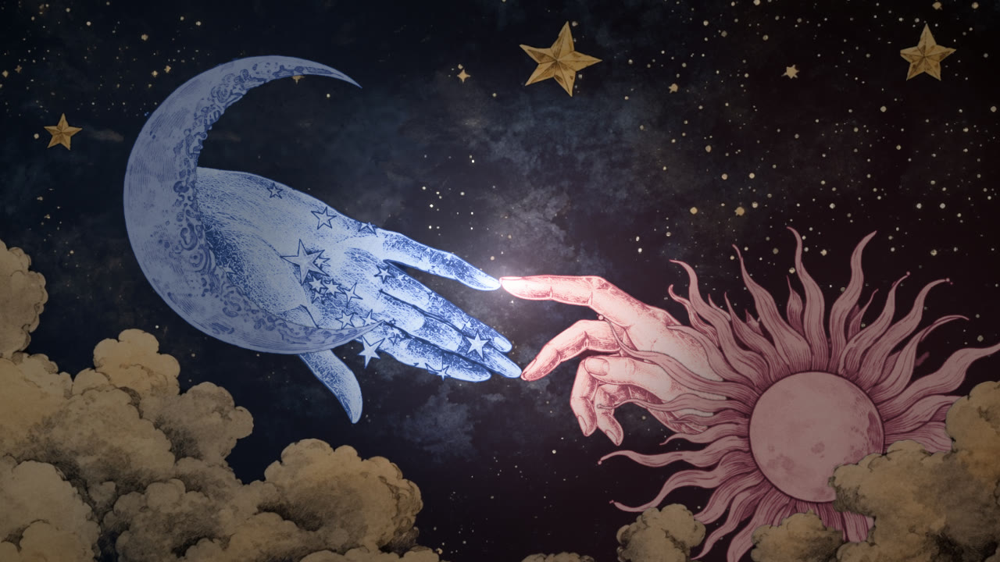
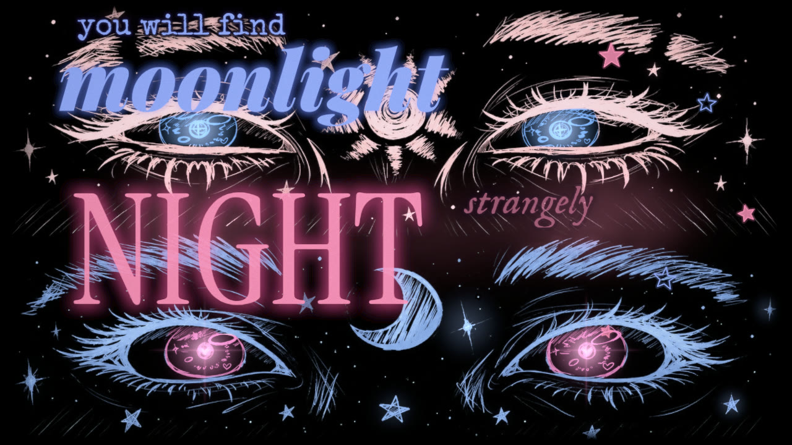
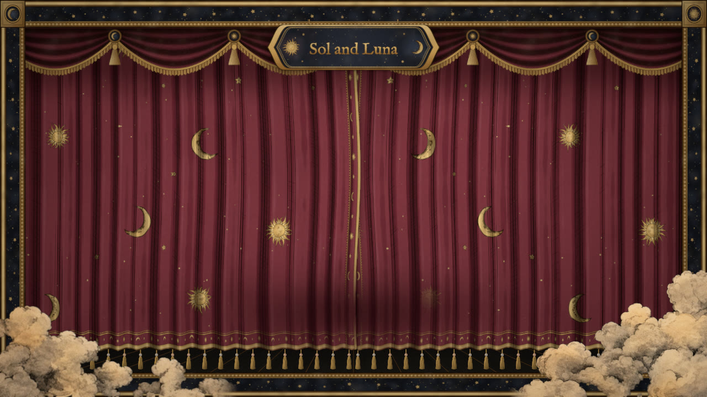

# Sun & Moon

A 52-second animated storybook that plays live in the browser. Curtains open, the Moon and the Sun talk to each other (voiced and subtitled) while their hands slowly reach out, and when their fingertips touch the scene opens into their eyes as a poem plays.

Built with Vite, TypeScript and three.js (WebGL).



## Screenshots

| | |
| --- | --- |
|  **Opening:** the stage lights up |  **Dialogue:** subtitles beside each speaker |
|  **The reach:** their hands move closer |  **The touch:** light at the fingertips |
|  **The eyes:** the poem as animated text |  **End:** curtains close, Press Enter to restart |

## How to run

You need **Node.js 22.18 or newer** and a browser with WebGL (Chrome, Edge, Firefox or Safari).

```bash
git clone https://github.com/ayushcpp/Sun-and-Moon.git
cd Sun-and-Moon
npm install
npm run dev
```

Open **http://localhost:5173** and click anywhere to turn on the sound (browsers block audio until you click).

### Production build

```bash
npm run build     # outputs to dist/
npm run preview   # serves dist/ at http://localhost:4173
```

The `dist/` folder works from any static host or sub-folder.

## Controls

| Key | Action |
| --- | --- |
| `Space` | Pause / play |
| `←` / `→` | Go back / forward 2 seconds |
| `Enter` | Restart (after the end) |
| `R` | Restart now |
| `M` | Sound on / off |
| `F` | Fullscreen |
| `H` | Hide / show on-screen hints |

On a phone, tap to start the sound and tap again at the end to restart.

To jump to a moment, add it to the URL: `http://localhost:5173/?t=30&paused=1` opens paused at 30 seconds.
